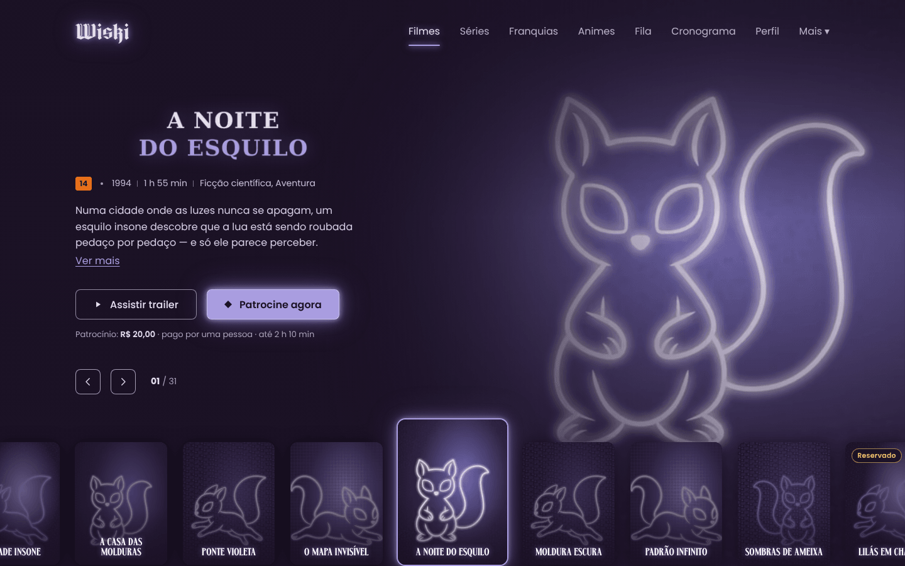

<p align="center">
  <picture>
    <source media="(prefers-color-scheme: dark)" srcset="public/brand/logo-wiski-lilac.svg">
    
  </picture>
</p>

<p align="center">
  <b>Wiskiflix</b> — the website of <a href="https://twitch.tv/iarawiski">Iara Wiski</a>'s movie lives.<br>
  Viewers pick (and sponsor) what she watches next.
</p>

<p align="center">
  <a href="https://wiski.fun">wiski.fun</a> ·
  <a href="docs/README.md">Docs</a> ·
  <a href="docs/phase-5/deploy-guide.md">Deploy guide</a> ·
  <a href="../../releases">Releases</a>
</p>

<p align="center">
  
</p>

## What it does

- **Catalog** of movies, series, animes and franchises, each with a price set by its runtime.
- **Pix payments** (Mercado Pago): a paid movie joins the queue; series and franchises are crowdfunded campaigns with a goal and a seat map.
- **Live schedule** (Cronograma), the queue (Fila), what's been watched (Assistidos) and viewer suggestions.
- **Community:** reviews with moderation, badges, a ranking, the daily wheel (Roleta), a yearly recap and the supporters' wall.
- **Stream overlays** for OBS (now watching, next up, sponsorships, subathon timer) and a Twitch chat bot.
- **Admin dashboard** for Iara and her moderators: catalog (filled from Wikidata), agenda, orders, people, audit log; second factor required.

## Stack

Next.js 16 (App Router) · React 19 · TypeScript · Tailwind CSS 4 · Prisma 7 + PostgreSQL 17 · Redis 7 · Zod 4 · Vitest · Playwright · Docker Compose + nginx in production.

## Run it locally

Needs Node 24 (`.nvmrc`) and Docker.

```sh
npm ci
npm run setup:dev                               # creates .env.local with fresh random secrets
docker compose -f docker/compose.dev.yml up -d  # Postgres + Redis
npm run db:migrate && npm run db:seed           # schema + a fictional catalog
npm run dev                                     # http://localhost:3000
npm run worker                                  # background jobs, in a second terminal
```

## Tests

```sh
npm run lint && npm run typecheck
npm test                    # unit
npm run test:integration    # against a real Postgres and Redis
npm run build && npm run test:e2e   # browser tests against the production build
npm run test:brand          # brand assets, pixel by pixel
```

CI runs all of them on every pull request, plus CodeQL, a migration drift check, a backup-restore drill and a smoke test of the production stack. Each merge to `main` builds the images and publishes a [release](../../releases) with its deploy block.

## Repository map

| Path | What's there |
| --- | --- |
| `src/app` | Pages and API routes (`(site)` public, `admin` dashboard, `overlay` for OBS, `api/v1`) |
| `src/server` | Server code by domain: catalog, checkout, payments, live, reviews, overlay, audit… |
| `src/components`, `src/styles` | UI components and CSS |
| `prisma` | Schema and migrations (`*_constraints` hold the reviewed SQL) |
| `tests` | Unit, integration, e2e and brand tests |
| `scripts` | Seed, brand pipeline, ops scripts (`scripts/ops`: deploy, backups, server setup) |
| `docker` | Dev and production Compose files, nginx template |
| `brand` | Original brand files (logo, mascot, patterns, fonts) |
| `docs` | Design, architecture and every phase's notes and test reports |

Rules for contributors (humans and AI agents) are in [`AGENTS.md`](AGENTS.md).

## License

All rights reserved. The code, the Wiski brand and its artwork are not licensed for reuse.
