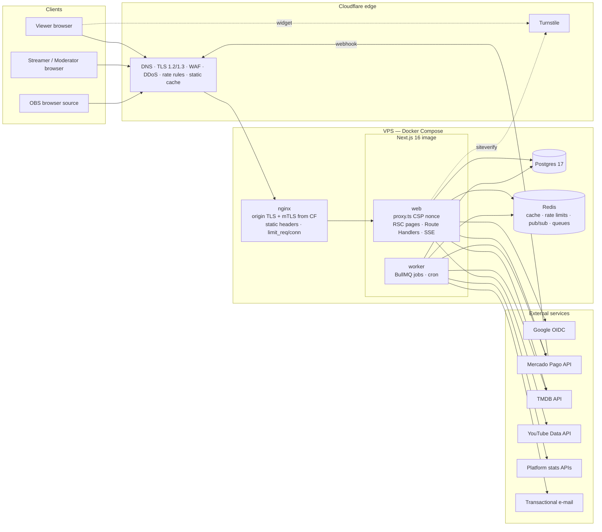
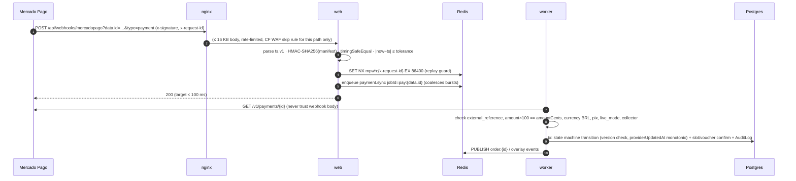

# 01 — Architecture

> Status: **rev 4** · Phase 0 · 2026-10-02 · canonical origin `https://wiski.fun`
> Rendered diagram: [`architecture.svg`](./architecture.svg) (Mermaid sources below render on GitHub / VS Code).

## 1. Goals and constraints

| Goal | Consequence for the design |
|---|---|
| Money must be right | Server-side price engine, integer cents, versioned price rules, Mercado Pago (MP) as the only source of truth for payment state. |
| Payment events must never be lost or double-applied | Signed webhooks → durable job queue → re-fetch from MP → idempotent state machine. Reconciliation poller covers missed webhooks. |
| Strict browser security (CSP nonces + `strict-dynamic`) | Every HTML page is **dynamically rendered** (nonces can't exist in static HTML). Caching moves to the data layer (Redis), not the HTML layer. |
| Small team, one VPS | One Next.js codebase, one Docker image used for two roles (`web` and `worker`), Postgres + Redis in the same Compose project, Cloudflare in front. |
| Live overlays in OBS | Server-Sent Events (one-way, auto-reconnect, works through Cloudflare and nginx). No WebSockets needed. |
| pt-BR first, mobile first | All UI copy in pt-BR, `Intl` formatting (`pt-BR`, `BRL`, `America/Sao_Paulo`), Tailwind mobile-first breakpoints. |

## 2. Component diagram



### Responsibilities

| Component | Owns | Never does |
|---|---|---|
| **Cloudflare** | DNS, edge TLS certificate, DDoS absorption, WAF managed rules, Turnstile, caching of `/_next/static/*` and `/brand/*`. Hides the origin IP. | Cache HTML or `/api/*` (bypass rule). Inject scripts (Rocket Loader, Email Obfuscation, etc. **off** — they break nonce CSP). |
| **nginx** | Origin TLS (Cloudflare Origin CA cert + Authenticated Origin Pulls mTLS), real client IP from `CF-Connecting-IP` (trusted only from CF ranges), static security headers (see 05 §7), body-size limits, timeouts, `limit_req`/`limit_conn`, SSE pass-through (`proxy_buffering off`). | Generate CSP (app owns it because of nonces). |
| **web** (Next.js) | Pages (RSC), Route Handlers under `/api/*`, CSP nonce per request in `proxy.ts`, auth, RBAC, Zod validation, price engine, MP payment creation, webhook intake (verify + enqueue only), SSE streams. | Long work inside a webhook request; trust client prices; render user HTML. |
| **worker** (same image, `node worker.js`) | BullMQ consumers: `payment.sync`, `payment.reconcile`, `slots.expire`, `stats.refresh`, `email.send`, `retention.purge`; publishes realtime events to Redis pub/sub. | Serve HTTP. |
| **Postgres** | System of record. Constraints + triggers for invariants (see 02 §4). | Be reachable from outside the Compose internal network. |
| **Redis** | Rate-limit counters, TMDB/YouTube/stats cache, Pix QR payload cache (TTL = expiry), session lookup cache (60 s), pub/sub fan-out for SSE, BullMQ queues. AOF persistence on (queues must survive restarts). | Hold anything that can't be rebuilt from Postgres or MP (except in-flight jobs, which reconciliation re-derives). |

## 3. Key flows

### 3.1 Login (Google OIDC, authorization code + PKCE + state + nonce)

```mermaid
sequenceDiagram
  autonumber
  participant B as Browser
  participant W as web
  participant G as Google
  B->>W: GET /api/auth/google/start?returnTo=/conta
  W->>W: state, nonce, code_verifier (256-bit each)<br/>returnTo validated (relative path allow-list)
  W-->>B: 302 accounts.google.com + Set-Cookie __Host-wf_oauth (sealed, 10 min, SameSite=Lax)
  B->>G: consent / account picker
  G-->>B: 302 /api/auth/google/callback?code&state
  B->>W: callback (+ __Host-wf_oauth)
  W->>W: constant-time state check, cookie deleted (one-time)
  W->>G: POST token (code + code_verifier)
  G-->>W: id_token (+ access_token, discarded)
  W->>W: verify id_token: JWKS signature, iss, aud, exp/iat, nonce, email_verified
  W->>W: upsert User by `sub`; create Session (rotate); first login → onboarding
  W-->>B: 302 returnTo (or /bem-vindo) + Set-Cookie __Host-wf_session
```

Library: **`openid-client` v6** (OpenID-certified RP library) + own server-side sessions. Rationale: full control over cookie names (`__Host-`), session revocation, step-up (`max_age` / `auth_time`) for admin actions, no extra adapter tables. (Alternative in Q-list: Better Auth.)

### 3.2 Sponsorship checkout (Pix)

```mermaid
sequenceDiagram
  autonumber
  participant B as Browser
  participant W as web
  participant R as Redis
  participant P as Postgres
  participant M as Mercado Pago
  B->>W: POST /api/v1/sponsorships/quote {movie | package | youtube, addOns, queueJumpTier, voucher}
  W->>P: active PriceRuleSet, catalog rules, voucher, slot availability (read-only)
  W-->>B: breakdown lines + totalCents (live preview, nothing stored)
  B->>W: POST /api/v1/sponsorships {same inputs, contactEmail (guest), displayName?, expectedTotalCents, legal versions, turnstile} + Idempotency-Key
  W->>W: Turnstile siteverify · rate limit · recompute price
  alt price changed
    W-->>B: 409 PRICE_CHANGED + new breakdown
  end
  W->>P: tx: Sponsorship(PENDING_PAYMENT) + Payment(PENDING) + LegalAcceptance×3 + voucher reservation + QueueJumpSlot reservation
  W->>M: POST /v1/payments (pix, amount, payer.email, external_reference, description, date_of_expiration=+30 min) + X-Idempotency-Key
  M-->>W: id, status=pending, point_of_interaction.transaction_data{qr_code, qr_code_base64}
  W->>P: Payment.providerPaymentId
  W->>R: SET pix:{sponsorshipId} {qr_code, qr_code_base64} EX ttl
  W-->>B: 201 {publicCode, accessToken (once), qrCode, qrCodeBase64, expiresAt} + Set-Cookie __Host-wf_order
  B->>W: GET /api/v1/sponsorships/{code}/events (SSE; polling fallback every 4 s)
```

Login is **not** required to sponsor. The order page URL is `/patrocinar/pedido/WF-XXXXXX#t=<accessToken>` — the token stays in the fragment, is exchanged once for the order cookie, and is repeated in the e-mail receipt, which is sent **only after the payment is approved**. Logged-in buyers get the moderator/VIP perk and can reschedule; a guest can attach the order to an account later ("Vincular à minha conta").

Webhooks are configured once in the Mercado Pago panel ("Webhooks › Configurar notificações", event *Pagamentos*) rather than per payment, so every notification carries the `x-signature` made with the panel's secret. Setup checklist: [09-mercadopago-setup.md](./09-mercadopago-setup.md).

### 3.3 Webhook → payment sync



Reconciliation: `payment.reconcile` runs every 15 s (since 2026-11-03; was 2 min): a Pix that can still be paid is re-read when not synced for 15 s, other open payments when not synced for 2 min, plus a nightly sweep of the last 48 h. A missed or late webhook therefore delays a confirmation by about 15 s; it can never lose it.

### 3.4 Overlay (OBS)

1. Streamer creates an overlay key in Admin → shown once → URL `https://wiski.fun/overlay/<widget>#k=<key>` (key in the **fragment**, so it never reaches server logs, Cloudflare logs or `Referer`).
2. Overlay page JS posts the key to `POST /api/v1/overlay/session` → `__Host-wf_overlay` cookie (read-only scope, 12 h, bound to the allowed widgets).
3. `GET /api/v1/overlay/stream` (SSE) streams sanitised JSON events; heartbeat comment every 20 s (Cloudflare idle timeout is 100 s); `retry: 3000`.
4. Overlay renders text via React text nodes only. No HTML, no Markdown, no user-supplied URLs.

## 4. Rendering, caching and performance

- **HTML is never cached** (`Cache-Control: private, no-store` on pages): nonce-based CSP requires a fresh nonce per response, and Next.js documents that nonce CSP disables static optimization/ISR/PPR. Pages call `await connection()` where needed.
- **Data is cached** in Redis with explicit TTLs: TMDB search 6 h, TMDB details 24 h, season details 24 h, YouTube video metadata 24 h, platform stats 15 min (+ last-known-good in Postgres), queue snapshot 5 s.
- **Static assets** (`/_next/static`, `/brand`, fonts) are immutable, hashed, `Cache-Control: public, max-age=31536000, immutable`, cached at Cloudflare.
- **Images**: TMDB posters go through `next/image` (served from our origin → CSP `img-src 'self'` only, no third-party hosts). Brand PNGs via `next/image`; brand SVGs inlined after a lossless SVGO pass (see 06 §5).
- Expected scale (your estimate): ≈ 1,000 visits/month with short peaks during lives. A 2 vCPU / 2 GB VPS is sufficient with per-container memory limits, a swap file and images built in CI (sizing in [08-hosting.md](./08-hosting.md) §1).

## 5. Conventions

| Topic | Rule |
|---|---|
| Money | `Int` cents end-to-end. Converted to MP `transaction_amount` only at the API boundary (`cents / 100`, asserted to round-trip). Display with `Intl.NumberFormat('pt-BR', {style:'currency', currency:'BRL'})`. |
| Time | Store UTC `timestamptz`. Business rules (daily/weekly caps, reschedule deadlines) evaluated in `America/Sao_Paulo`; ISO weeks start Monday 00:00 BRT. |
| IDs | UUIDv7 internally; `publicCode` (Crockford base32, 6 chars + prefix) for anything a human reads. |
| Validation | Zod schema on **every** input (body, query, params, headers we read, webhook payloads, env vars at boot, JSON columns on read). Unknown keys rejected (`.strict()`). Length limits before regexes. |
| Errors | RFC 9457 `application/problem+json`, stable `code` field, pt-BR `detail`, no stack traces or internal IDs. |
| Logs | pino JSON to stdout, one `requestId` per request; redaction list for `authorization`, cookies, e-mail, IP (logged only as keyed HMAC), Pix payloads. |
| TMDB attribution | Site footer and the catalog page (`/patrocinar`) show TMDB's approved logo (self-hosted, less prominent than our brand) and the exact required notice: "This product uses the TMDB API but is not endorsed or certified by TMDB." followed by the pt-BR translation. Also listed on a "Créditos" section of `/termos`. YouTube results show the video title/channel and link to YouTube. |
| DB access | Prisma only. Raw SQL limited to reviewed migration files (constraints/triggers/grants) and `SELECT 1` health check via tagged template. |

## 6. Repository layout (Phase 1)

```
wiskiflix/
├─ ASSETS/                    # originals, untouched (source of truth)
├─ docs/phase-0/              # this spec
├─ public/brand/              # build output of scripts/brand-assets.ts (renamed + lossless SVGO)
├─ prisma/schema.prisma       # from schema.draft.prisma after approval
├─ prisma/migrations/         # incl. reviewed SQL for CHECKs/triggers/grants
├─ prisma.config.ts
├─ src/
│  ├─ app/                    # routes (pt-BR slugs), layouts, route handlers under app/api
│  ├─ proxy.ts                # CSP nonce, Reporting-Endpoints
│  ├─ server/                 # auth/, rbac/, pricing/, payments/mercadopago/, catalog/, reviews/,
│  │                          # ratelimit/, turnstile/, sanitize/, audit/, realtime/, env.ts (Zod)
│  ├─ worker/                 # BullMQ processors + schedules
│  ├─ components/             # UI (server-first; client components only where interactive)
│  └─ generated/prisma/       # Prisma 7 client output (git-ignored)
├─ tests/unit · tests/integration · tests/e2e (Playwright)
├─ docker/ (Dockerfile, compose.yml, nginx/)
└─ .github/workflows/ (ci.yml, codeql.yml) · .github/dependabot.yml
```

## 7. Versions (to pin in Phase 1)

Next.js 16.x (App Router, `proxy.ts`), React 19, TypeScript 5.x strict (+ `noUncheckedIndexedAccess`, `exactOptionalPropertyTypes`), Prisma 7 + `@prisma/adapter-pg`, Postgres 17, Redis 7/8, Tailwind CSS 4 (CSS-first `@theme`), Zod 4, BullMQ 5, `openid-client` 6, Vitest, Playwright, nginx stable (mainline if HTTP/3 wanted later), Node 22/24 LTS. Exact versions get pinned in the lockfile; Dependabot keeps them moving.
