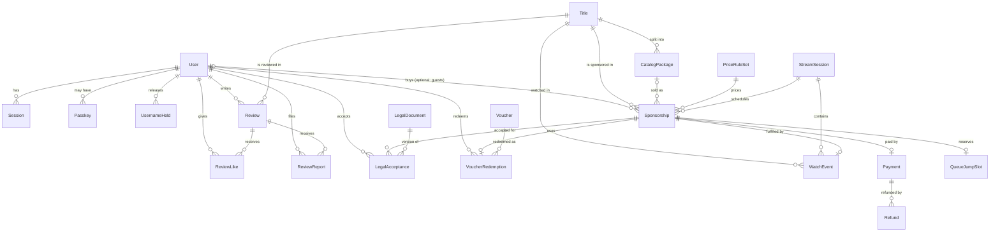

# 02 — Data model

> Status: **rev 3** (guest checkout, VIP perk, per-season packages with price override, fixed queue-jump tiers, exception-only refunds). Full Prisma source: [`schema.draft.prisma`](./schema.draft.prisma) (Prisma 7). It was hand-checked; `prisma validate` and a first migration run in Phase 1 (the package registry wasn't reachable from this environment). · **R1 delta (2026-10-02) at the top — read it first**

## R1 delta (2026-10-02) — what the database looks like now

Source of truth: `prisma/schema.prisma` + `prisma/migrations/20261002230000_r1_catalog` (generated) and `20261002230100_r1_constraints` (reviewed SQL). Rules: [11-redesign-spec.md](./11-redesign-spec.md) §7; build notes: [`../r1/README.md`](../r1/README.md).

**Removed:** `Title`, `CatalogRule`, `CatalogPackage`, `Sponsorship`, `MediaSource`, the `YOUTUBE`/`ANIME` kinds and everything TMDB. **Repointed** to the new tables: `Payment` → `Order`, `LegalAcceptance` (`orderId`), `VoucherRedemption`, `QueueJumpSlot`, `WatchEvent` and `Review` (`itemId`).

| Model | Purpose | Key rules |
|---|---|---|
| `CatalogItem` | one movie, series or franchise the moderation curates (title, year, runtime, ClassInd rating, genres, synopsis ≤ 600, cast, trailer id, poster/backdrop/logo) | `kind` MOVIE/SERIES/FRANCHISE; status `DRAFT → ACTIVE → SPONSORED/FUNDED → WATCHED → ARCHIVED`; `slot` 1–35 (movies) / 1–10; `version` for optimistic concurrency; `trailerYoutubeId` is the 11-char id only |
| `FranchiseEntry` | films inside a franchise | goal formula Σ movie prices |
| `CatalogRevision` | full Zod-validated snapshot per change (`version`, `note`, editor) | unique `(itemId, version)`; revert = new revision with an old snapshot |
| `MediaAsset` | a processed upload (`sha256` of the master, role, size, AVIF/WebP `variants`) | unique `sha256` (dedup); originals never stored; `unusedSince` for GC |
| `Campaign` | crowdfunding of one series/franchise | `remaining = goal − raised − reserved ≥ 0`; `OPEN → PAUSED/FUNDED → SCHEDULED → WATCHED`; STREAMER opens/extends/changes goal |
| `Order` | the checkout record, `MOVIE` (one sponsor pays the movie price) or `CONTRIBUTION` (≥ R$ 5 to a campaign) — replaces `Sponsorship` | kind-specific columns by CHECK; at most one active MOVIE order per item (partial unique `order_one_active_movie`) |

**Reviewed SQL (`*_r1_constraints`)** — every one has an integration test (`tests/integration/db-constraints-r1.test.ts`):

- `CatalogItem`: `ci_slug_format`, `ci_text_len`, `ci_year`, `ci_runtime` (movies 1–360 min), `ci_slot_range`, `ci_slot_state` (live ⇒ slot), `ci_status_kind` (SPONSORED only for movies, FUNDED only for campaigns), `ci_series_fields`, `ci_trailer_id`, `ci_reservation`, `ci_lifecycle_times`, `ci_version`.
- `ci_live_slot_unique`: `EXCLUDE … (kind, slot) WHERE live … DEFERRABLE INITIALLY DEFERRED` — one live item per slot, checked at commit so two slots can be swapped in one transaction.
- Trigger `catalog_item_guard`: live limits **35 movies / 10 series / 10 franchises**, counted under a per-kind advisory lock; raises SQLSTATE `WF409` (mapped to HTTP 409).
- `fe_values`, `rev_values`, `media_values`; `camp_money`, `camp_remaining`, `camp_funded`, `camp_deadline`; `ord_money_nonneg`, `ord_total_consistent`, `ord_contact_email`, `ord_version`, `ord_movie_fields`, `ord_contribution_fields` (whole reais ≥ R$ 5, no perks); `la_subject` (user or order).

**Money stays integer cents, time stays UTC.** Movie price = R$ 20,00 up to 130 min, then +R$ 1,00 per started minute (11 §2.1); series default goal R$ 100,00 × seasons; franchise goal = Σ its films' movie prices.

---

*The sections below are the Phase 0 baseline (rev 3); where they differ from the R1 delta above, the delta wins.*

## 1. Entity overview



Stand-alone tables: `CatalogRule`, `Goal`, `OverlayKey`, `PlatformStat`, `ContactMessage`, `AppSetting`, `WebhookEvent`, `AuditLog`.

## 2. Design decisions

| Decision | Why |
|---|---|
| Guest checkout: `Sponsorship.userId` nullable, `contactEmail` required, `accessTokenHash` unique | Login isn't required to sponsor. The buyer is the user, or the (lower-cased) contact e-mail for caps/limits; the order link token is the only way a guest reaches the order. `claimedAt` records a later attach-to-account. |
| VIP is a flag, not a role | `User.isVip` grants the 10 % perk only; it gives no admin capability, so it can't widen RBAC by mistake. Set by STREAMER (step-up, audited). |
| `CatalogPackage` for series/anime | One package = one whole season, priced per season (R$ 100 default, streamer override with reason). Runtime/episode count come from TMDB at build time and feed session capacity. The admin controls what is offered. |
| Identity = Google `sub`, not e-mail | E-mails change and can be recycled; `sub` is stable. Prevents account-linking takeovers. |
| `username` nullable until onboarding, lowercase canonical, ASCII `[a-z0-9_]{3,20}` | Unique index works directly; no homoglyph impersonation; onboarding is a separate step after first login. |
| Server-side sessions (hashed token) | Instant revocation (logout everywhere, role change, suspension); DB leak doesn't leak usable cookies. |
| Pricing config as versioned JSON (`PriceRuleSet`) | Atomic publish of a coherent price table; each order pins the exact version + a `breakdown` snapshot → disputes are answerable years later. Zod validates on write **and** read. |
| No quote table | `/quote` is a pure function for the live preview; `/sponsorships` recomputes. Less state, nothing to tamper with. |
| `QueueJumpSlot` with `(day, dayIndex)` / `(isoWeek, weekIndex)` uniques + `tierId` | Fixed tiers share the daily/weekly caps; the database enforces them even under concurrency, without serializable transactions or locks. Released reservations are deleted to free the slot. |
| `Payment` holds only provider id, status, amount, timestamps | Requirement: no card/bank data. Pix QR payloads live in Redis with TTL = expiry and can be re-fetched from MP. |
| `WebhookEvent.requestId` unique + `Payment.providerPaymentId` unique | Two independent idempotency guarantees: per delivery and per payment. |
| `version` columns on `Sponsorship` / `Payment` | Optimistic concurrency so concurrent webhook workers can't regress state. |
| `likeCount` denormalised | Sorting by "top" without COUNT(*) per row; updated in the same transaction as the like row. |
| `Title` stores a minimal snapshot | Needed for orders/reviews to stay readable even if TMDB changes; minimal fields only (see Q4 on TMDB terms). Search results are never persisted. |
| Legal texts versioned in git, hash pinned in `LegalDocument` | Proves exactly which text the buyer accepted (`LegalAcceptance` per document per order). |

## 3. State machines

**Sponsorship**

```
PENDING_PAYMENT ─approved────────▶ PAID ─schedule─▶ SCHEDULED ─live─▶ WATCHING ─▶ COMPLETED
PENDING_PAYMENT ─expired─────────▶ EXPIRED ─late approval─▶ NEEDS_ATTENTION
PENDING_PAYMENT ─cancel──────────▶ CANCELLED
SCHEDULED       ─reschedule──────▶ SCHEDULED (another session)
SCHEDULED       ─session cancelled▶ PAID (owner picks a new session)
PAID | SCHEDULED | NEEDS_ATTENTION ─refund─▶ REFUND_PENDING ─▶ REFUNDED
any paid state  ─anomaly─────────▶ NEEDS_ATTENTION ─resolved─▶ PAID
```

**Payment** (mirrors MP, forward-only): `PENDING → APPROVED | REJECTED | CANCELLED`; `APPROVED → REFUNDED | CHARGED_BACK | IN_MEDIATION`; `IN_MEDIATION → APPROVED | CHARGED_BACK | REFUNDED`. A transition is applied only if it is in this table, `date_last_updated` is not older than the stored one, and the row `version` matches.

## 4. Constraints added as reviewed migration SQL

Prisma's schema language cannot express these, so they go into hand-written, code-reviewed SQL inside the migration folder. This is the only raw SQL in the project (justification: database-enforced invariants beat application-only checks).

```sql
-- value checks
ALTER TABLE "Review"        ADD CONSTRAINT review_rating_range   CHECK (rating BETWEEN 1 AND 5);
ALTER TABLE "Review"        ADD CONSTRAINT review_body_len       CHECK (char_length(body) BETWEEN 1 AND 2000);
ALTER TABLE "User"          ADD CONSTRAINT user_username_format  CHECK (username IS NULL OR username ~ '^[a-z0-9_]{3,20}$');
ALTER TABLE "Sponsorship"   ADD CONSTRAINT sp_money_nonneg       CHECK ("subtotalCents" >= 0 AND "discountCents" >= 0 AND "queueJumpCents" >= 0 AND "totalCents" > 0);
ALTER TABLE "Sponsorship"   ADD CONSTRAINT sp_total_consistent   CHECK ("totalCents" = "subtotalCents" - "discountCents" + "queueJumpCents");
ALTER TABLE "Payment"       ADD CONSTRAINT pay_amount_pos        CHECK ("amountCents" > 0);
ALTER TABLE "Refund"        ADD CONSTRAINT refund_amount_pos     CHECK ("amountCents" > 0);
ALTER TABLE "QueueJumpSlot" ADD CONSTRAINT qj_multiplier_bounds  CHECK ("multiplierBps" BETWEEN 8000 AND 16000);
ALTER TABLE "QueueJumpSlot" ADD CONSTRAINT qj_index_nonneg       CHECK ("dayIndex" >= 0 AND "weekIndex" >= 0);
ALTER TABLE "StreamSession" ADD CONSTRAINT ss_capacity           CHECK ("bookedMinutes" >= 0 AND "bookedMinutes" <= "capacityMinutes");
ALTER TABLE "Voucher"       ADD CONSTRAINT voucher_kind_values   CHECK (
  (kind = 'PERCENT' AND "percentBps" BETWEEN 1 AND 10000 AND "amountCents" IS NULL) OR
  (kind = 'FIXED'   AND "amountCents" > 0 AND "percentBps" IS NULL));
ALTER TABLE "Sponsorship"   ADD CONSTRAINT sp_contact_email      CHECK ("contactEmail" = lower("contactEmail") AND char_length("contactEmail") BETWEEN 6 AND 254);
ALTER TABLE "LegalAcceptance" ADD CONSTRAINT la_subject          CHECK ("userId" IS NOT NULL OR "sponsorshipId" IS NOT NULL);
ALTER TABLE "CatalogPackage" ADD CONSTRAINT pkg_values            CHECK ("seasonNumber" >= 0 AND "episodeCount" >= 1 AND "runtimeMinutes" > 0);
ALTER TABLE "CatalogPackage" ADD CONSTRAINT pkg_price_override    CHECK (("priceOverrideCents" IS NULL AND "priceOverrideReason" IS NULL) OR ("priceOverrideCents" > 0 AND char_length("priceOverrideReason") >= 3));
ALTER TABLE "Voucher"       ADD CONSTRAINT voucher_count         CHECK ("redemptionCount" >= 0 AND ("maxRedemptions" IS NULL OR "redemptionCount" <= "maxRedemptions"));

-- "exactly one" rules
CREATE UNIQUE INDEX one_active_ruleset   ON "PriceRuleSet"  (status)  WHERE status = 'ACTIVE';
CREATE UNIQUE INDEX one_current_legaldoc ON "LegalDocument" (type)    WHERE "isCurrent";

-- append-only, hash-chained audit log
CREATE EXTENSION IF NOT EXISTS pgcrypto;
CREATE FUNCTION audit_log_chain() RETURNS trigger AS $$
DECLARE last_hash bytea;
BEGIN
  PERFORM pg_advisory_xact_lock(hashtext('audit_log_chain'));
  SELECT hash INTO last_hash FROM "AuditLog" ORDER BY id DESC LIMIT 1;
  NEW."prevHash" := COALESCE(last_hash, '\x00'::bytea);
  NEW.hash := digest(NEW."prevHash" || convert_to(
      concat_ws('|', NEW.at, NEW."actorId", NEW."actorRole", NEW.action, NEW."targetType", NEW."targetId", NEW.metadata::text, NEW."requestId"),
      'UTF8'), 'sha256');
  RETURN NEW;
END $$ LANGUAGE plpgsql;
CREATE TRIGGER audit_log_chain BEFORE INSERT ON "AuditLog" FOR EACH ROW EXECUTE FUNCTION audit_log_chain();

CREATE FUNCTION audit_log_immutable() RETURNS trigger AS $$
BEGIN RAISE EXCEPTION 'AuditLog is append-only'; END $$ LANGUAGE plpgsql;
CREATE TRIGGER audit_log_no_update BEFORE UPDATE OR DELETE ON "AuditLog" FOR EACH ROW EXECUTE FUNCTION audit_log_immutable();

-- least-privilege roles (names illustrative)
REVOKE ALL ON "AuditLog" FROM wf_app;
GRANT SELECT, INSERT ON "AuditLog" TO wf_app;
GRANT USAGE ON SEQUENCE "AuditLog_id_seq" TO wf_app;
```

A nightly worker job verifies the hash chain end-to-end and alerts on a break.

## 5. Retention (proposal — Q14)

| Data | Retention | Basis (LGPD art. 7) |
|---|---|---|
| Account (sub, e-mail, username, avatar) | while active; erased/anonymised on request | contract |
| Sessions | until expiry + 30 days | legitimate interest (security) |
| Sponsorships (incl. guest contact e-mail), payments, refunds, legal acceptances | 5 years after payment (to confirm with accountant) | legal/regulatory obligation |
| Reviews, likes, reports | while account active; on erasure: reviews removed (or anonymised, Q14) | contract / legitimate interest |
| Contact messages | 12 months (`purgeAfter`) | legitimate interest |
| Webhook events | 90 days | legitimate interest |
| Audit log | 5 years | legitimate interest / legal |
| App logs | 30 days | legitimate interest (security) |
| Redis caches / Pix payloads | minutes to 24 h (TTL) | contract |
