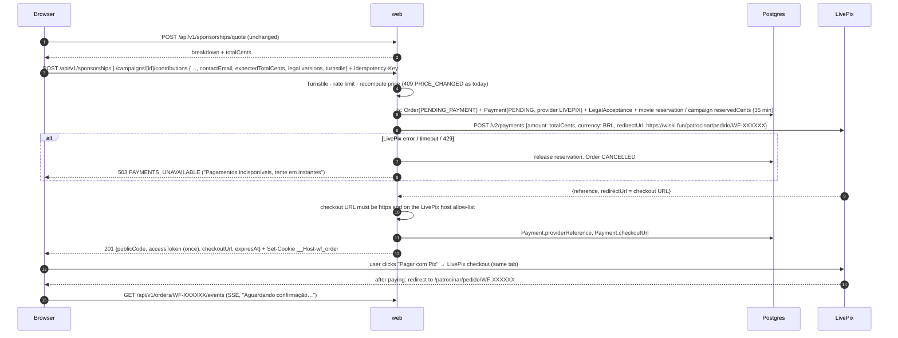
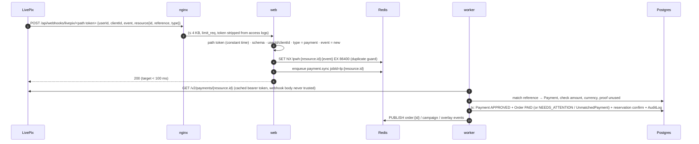

# 13 — LivePix instead of Mercado Pago (payments design, for comparison)

> Status: **not chosen — kept for reference.** On 2026-10-29 the site's checkout stayed on Mercado Pago (built in [Phase 2](../phase-2/README.md)); LivePix keeps handling donations on stream. Written 2026-10-28 from LivePix's public API docs and OpenAPI spec (v2.0.0) and its fee page.

This is the same Phase 2 (movie checkout "Patrocine agora", campaign contributions "Contribuir", guest checkout, webhook, reconciliation, order pages), redesigned for LivePix. It keeps every rule from 11 (35-minute reservation, one sponsor per movie, no overfunding, no refunds except the exception tool) and the guard pipeline from Phase 1. Section 9 puts the two designs side by side.

## 1. What LivePix's API gives us

| Need | LivePix API v2 (`https://api.livepix.gg/v2`) |
|---|---|
| Auth | OAuth2 **client credentials** for your own account: `POST https://oauth.livepix.gg/oauth2/token` → bearer token, `expires_in` ≈ 3600 s. Docs: reuse tokens until they expire; "uso excessivo pode resultar em suspensão da conta". |
| Scopes we'd use | `account:read` · `payments:read` · `payments:write` · `webhooks` · `wallet:read` (plus `messages:write` for option §2.6) |
| Create a charge | `POST /v2/payments` `{amount (cents, ≥ 100), currency: "BRL", redirectUrl}` (+ optional `split`) → `201 {data: {reference, redirectUrl}}`. `redirectUrl` in the response is **LivePix's checkout page**. No field for our order id, no description, no payer e-mail, no expiry, no idempotency key. |
| Read payments | `GET /v2/payments/{id}` → `{id, proof, reference, amount, currency, createdAt}`. `GET /v2/payments?reference=&proof=&currency=&page=&limit=`. Described as "pagamentos **recebidos**". **No status field.** |
| Cancel / expire / refund | **none** in the API |
| Webhooks | `POST /v2/webhooks {url}` (≤ 3 per client, 10 calls/hour). Body: `{userId, clientId, event: "new", resource: {id, reference, type: "payment" \| "message" \| "subscription"}}` — "apenas algumas informações básicas", fetch details from the API. Retries every 10 min for 24 h until HTTP 200. **No signature, secret, request id or source-IP list documented.** |
| Wallet | `GET /v2/wallet` (balance, held, pending), `GET /v2/wallet/BRL/transactions` (proof, signed amount, balance), `…/receivables` (amount, `releaseAt`) — 100 calls/hour |
| Rate limits | payments endpoints 1000 req/min; headers `X-RateLimit-Limit/Remaining/Reset`; 429 when exceeded |
| Test mode | **none documented** — no sandbox, no test credentials |
| Fees (livepix.gg/taxas) | **5 %** per Pix (min R$ 0,01) · 7 % card · 7 % international · first 3 withdrawals per month free, then R$ 0,50 each |

The key consequence: a LivePix payment **exists only once it has been paid**. Before that we only hold the `reference` LivePix gave us when we created the request.

## 2. Flows

### 2.1 Checkout (movie or contribution)



What changes for the visitor: no QR code on our page. The order page shows the summary, a countdown and a **"Pagar com Pix"** button that opens LivePix's checkout; LivePix sends them back to the order page, which waits for the webhook. The order cookie is set **before** the redirect, so the return URL carries no token. Guests still get the order link with `#t=` by e-mail after payment.

LivePix has no idempotency key, so a retried `POST /v2/payments` could create two requests. That's harmless: an unpaid request costs nothing, and only the reference we stored (and its URL) is ever shown to the buyer.

### 2.2 Webhook → payment sync



### 2.3 Reconciliation

- **Every 2 min:** for each `PENDING` payment not synced in 2 min, `GET /v2/payments?reference=<providerReference>`. Found → same sync as the webhook. Polling is the safety net, because a webhook can be lost or rejected.
- **Late window:** keep polling `EXPIRED` orders for **24 h** after expiry (see §2.4). The checkout link may still be payable, and LivePix only retries webhooks for 24 h.
- **Nightly:** page through `GET /v2/payments` back to 48 h ago. Any payment whose reference we don't know, or haven't processed, goes to the review queue. The docs show no date filter, so this assumes newest-first ordering (**unknown**, §11).
- At a few pending orders, all of this stays far below 1000 req/min.

### 2.4 Expiry and late payments (the hard part)

Mercado Pago lets us set `date_of_expiration`, so the Pix QR dies with the reservation. **LivePix offers no expiry or cancel.** So the 35-minute reservation becomes ours alone:

1. After 35 min the order becomes `EXPIRED`, the button disappears, the movie or the reserved contribution amount is released, and the order page says "Pedido expirado — não pague mais este link".
2. A buyer who left LivePix's checkout tab open may **still pay** (**unknown** whether LivePix stops it). When that payment arrives for an expired order:
   - **Movie:** try the same conditional reservation as a new checkout (`ACTIVE` and not reserved). It wins → `PAID` (audited as `late_payment_accepted`). It loses because someone else bought the movie → `NEEDS_ATTENTION`, and the streamer refunds by hand (§2.5).
   - **Contribution:** try the conditional `remainingCents ≥ amount` decrement. It wins → `PAID`. It loses because the campaign is full or closed → `NEEDS_ATTENTION`.
3. **The same link paid twice** (**unknown** whether possible): the second payment can't attach to the order (one `Payment` per order). It goes to `UnmatchedPayment` with reason `DUPLICATE_FOR_ORDER`, and the streamer refunds it by hand.
4. "Cancelar pedido" on an unpaid order only cancels it **on our side**. LivePix has nothing to cancel, so step 2 applies if the old link is paid anyway.

With Mercado Pago these cases are rare edge cases. With LivePix they're **expected now and then**, and each one needs a person.

### 2.5 Refunds and chargebacks (manual)

- **Exception refunds** (duplicate, processing error, legal requirement) become **"Registrar reembolso manual"**. The streamer sends the Pix back from their own bank or LivePix balance, then records it in Admin with the outgoing Pix end-to-end id. It's STREAMER-only, with step-up, `Idempotency-Key` and an audit entry, as today. Whether LivePix support can reverse a payment is **unknown**.
- **MED / chargebacks:** the API documents no notification. A nightly `wallet.audit` job reads `GET /v2/wallet/BRL/transactions`; any **debit** whose `proof` matches a paid order marks that order `NEEDS_ATTENTION` ("possível MED/estorno") and alerts the streamer. Whether LivePix records reversals there is **unknown**.
- Card payments (7 %, chargeback risk) only matter if LivePix's checkout offers cards to our buyers and we can't turn them off (**unknown**).

### 2.6 On-stream alerts (option)

A charge made with `POST /v2/payments` probably **doesn't** play a LivePix alert on stream (**unknown**). Our own overlay (Q20, SSE) works the same with either provider. Alternative: create the charge with `POST /v2/messages` `{username: <your LivePix user>, message, amount, currency, redirectUrl}`. Then the sponsorship plays as a normal LivePix alert, and its webhook arrives as `type: "message"`.

- **For:** native alert and TTS with no extra overlay work.
- **Against:** LivePix messages are capped at 32 characters, and the text plays immediately. That breaks Q10 (a sponsor message shows only after moderator approval). So the message must be **our fixed text**, e.g. `Patrocínio: <título curto>`, never the buyer's.

Recommendation if LivePix is chosen: start with `payments` plus our own overlay, and try `messages` later.

## 3. Webhook handler spec (replaces 05 §6 for LivePix)

```
POST /api/webhooks/livepix/<LIVEPIX_WEBHOOK_PATH_TOKEN>
Body: {"userId":"…","clientId":"…","event":"new","resource":{"id":"…","reference":"…","type":"payment"}}
```

1. **Envelope:** POST, `content-type` JSON, body ≤ 4 KB.
2. **Path token:** 32 random bytes (base64url) compared with `timingSafeEqual`, also against `LIVEPIX_WEBHOOK_PATH_TOKEN_PREVIOUS` during rotation. Mismatch → **404** (don't confirm the endpoint exists) + security event. nginx logs `/api/webhooks/livepix/[redacted]`.
3. **Schema:** Zod `.strict()`; ids match the documented format (24 hex characters in every example — confirm, §11). A failure returns **200 `IGNORED_SCHEMA`** + alert, not 4xx. A 4xx would make LivePix retry for 24 h and then drop the event. If LivePix adds a field, we fall back to the 2-minute polling and see the alert.
4. **Filter:** `userId` = `LIVEPIX_ACCOUNT_ID`, `clientId` = `LIVEPIX_CLIENT_ID`, `type` = `payment`, `event` = `new`; anything else → 200 `IGNORED`. **This is filtering, not authentication:** both ids are not secret. Donations (`message`) and subscriptions on the same account land here too and are ignored without an API call.
5. **Duplicates:** `SET lpwh:{resource.id}:{event} NX EX 86400`; already set → 200 `DUPLICATE`.
6. **Persist + enqueue:** `WebhookEvent` (unique `dedupeKey`), BullMQ `payment.sync` with `jobId = lp:{resource.id}`, **200**.
7. **Worker `payment.sync`:** `GET /v2/payments/{id}` with our token. That response is the only source of truth. Checks:
   - `data.id` = `resource.id`;
   - `data.reference` matches exactly one of **our** `Payment.providerReference` (else `UnmatchedPayment` `UNKNOWN_REFERENCE`);
   - `amount` = `amountCents`;
   - `currency` = `BRL`;
   - `proof` is non-empty and not already used (unique).

   Any mismatch → `NEEDS_ATTENTION` / `UnmatchedPayment` + alert, **never `PAID`**.
8. **State machine:** `PENDING → APPROVED` (payment exists), plus the manual `APPROVED → REFUNDED` (§2.5) and `CHARGED_BACK` (wallet audit). `EXPIRED`/`CANCELLED` are set by us. It's idempotent: unique `providerPaymentId` and `proof`, optimistic `version`, and the same state again is a no-op.
9. **Side effects in one transaction**, as today: order `PAID`, reservation confirmed (movie sold / `reservedCents → raisedCents`), audit row; after commit, `PUBLISH`.
10. **Quota guard:** nginx `limit_req` 30 r/min per IP on this path, jobs coalesce per id, and a global cap of 300 `payment.sync` calls/min. Faked webhooks can't use up the 1000 req/min we need for real checkouts. On 429, retry after `X-RateLimit-Reset` with jitter.

**Token handling:** the bearer is cached in Redis (`lp:token`, TTL = `expires_in − 120 s`). Fetching a new one is single-flight (`SET lp:token:lock NX EX 10`), so workers never request tokens in parallel. A 401 refreshes once, then the call fails. At start-up the worker calls `GET /v2/account` and refuses to run if the account id isn't `LIVEPIX_ACCOUNT_ID`. That's the equivalent of today's "access token must belong to `MP_COLLECTOR_ID`" boot check.

## 4. Data model delta (against `prisma/schema.prisma`)

| Model | Change |
|---|---|
| `enum PaymentProvider` | add `LIVEPIX` |
| `Payment` | **add** `providerReference String? @unique` (from create), `checkoutUrl String?` (allow-listed https URL), `proof String? @unique` (Pix end-to-end id). `providerPaymentId` is now filled when the payment **arrives**, not at creation. `expiresAt` is our reservation deadline only. `providerUpdatedAt`/`statusDetail` unused for LivePix. `idempotencyKey` stays internal. |
| `WebhookEvent` | `requestId` → `dedupeKey` (`lp:{id}:{event}`); `signatureTs` nullable |
| **new** `UnmatchedPayment` | `providerPaymentId @unique`, `reference`, `amountCents`, `currency`, `proof @unique`, `receivedAt`, `reason` (`UNKNOWN_REFERENCE` · `DUPLICATE_FOR_ORDER` · `AMOUNT_MISMATCH`), `resolution` (`REFUNDED_MANUALLY` · `KEPT` · `ATTACHED_TO_ORDER`), `resolvedAt`, `resolvedById`. Kept 5 years like orders (Q14). |
| `Refund` | **add** `method` (`PROVIDER_API` · `MANUAL_PIX`) and `outgoingProof` (end-to-end id of the Pix the streamer sent); `providerRefundId` null for manual refunds |
| `Order` | unchanged (a late payment with no capacity ends in `NEEDS_ATTENTION`, which exists already) |
| Redis | the `pix:{orderId}` QR cache goes away; new `lp:token`, `lp:token:lock`, `lpwh:*` |

## 5. API surface delta (against 03 §5.3 as generalised in 11 §9)

| Endpoint | Change |
|---|---|
| `POST /api/v1/sponsorships`, `POST /api/v1/campaigns/[id]/contributions` | response `{publicCode, accessToken, checkoutUrl, expiresAt}` instead of `qrCode`/`qrCodeBase64`; 503 `PAYMENTS_UNAVAILABLE` when LivePix fails (reservation released) |
| `GET /api/v1/orders/[code]` | `checkoutUrl` while `PENDING_PAYMENT` and not expired; no Pix payload |
| `POST /api/v1/orders/[code]/cancel` | local only (nothing to cancel at LivePix) |
| `POST /api/webhooks/mercadopago` | replaced by `POST /api/webhooks/livepix/[token]` (§3), access H, own allow-list like today |
| **new** `GET /api/v1/admin/payments/unmatched` · `POST …/[id]/resolve` | STREAMER + passkey + Google step-up; added to the authz matrix |
| `POST /api/v1/admin/sponsorships/[id]/refund` (orders, after 11 §9) | becomes "record a manual refund" (`MANUAL_PIX`, `outgoingProof`) |
| CSP | no new origins: the checkout is a top-level navigation, and no QR `data:` images are needed |

## 6. Configuration and secrets (replaces 09 §B for LivePix)

| `.env` key | Secret? | Notes |
|---|---|---|
| `LIVEPIX_CLIENT_ID` | no (treat as config) | from the application you create in LivePix › Configurações › Aplicações |
| `LIVEPIX_CLIENT_SECRET` | **yes** | server only; checked by `check:bundle-secrets` + gitleaks rule |
| `LIVEPIX_ACCOUNT_ID` | no | your LivePix user id (`GET /v2/account`); boot check in §3 |
| `LIVEPIX_WEBHOOK_PATH_TOKEN` / `…_PREVIOUS` | **yes** | `npm run setup:dev` generates it; registered with `POST /v2/webhooks` by a small `npm run livepix:webhooks` script (list / add / remove; ≤ 3 per client, 10 calls/hour) |

The `MP_*` keys and their boot checks leave `src/server/env.ts` and `.env.example` (or stay, if §10 option C is chosen).

**What a leaked client secret can do.** It can create payment requests (paid money still goes to you), read payments and the wallet, and add or delete webhooks. An attacker could watch sales or delete our webhook, and polling covers that. The API documents **no refunds or withdrawals**. That's a smaller blast radius than the Mercado Pago access token, which can issue refunds. Withdrawals happen in LivePix's own site, so **two-factor login on the LivePix account** is the control that matters most.

**Development:** with no test mode, use a **separate LivePix application** (its own client id and secret) for development, so it can be revoked on its own. Payments are still real money on the same account (§8). Webhooks in development need a public URL (e.g. a Cloudflare tunnel); without one, the 2-minute polling still completes orders.

## 7. Threat model delta (against 05)

| Threat | Mercado Pago design | LivePix design |
|---|---|---|
| Forged webhook marks an order paid | HMAC `x-signature` + freshness + replay guard, then re-fetch | **no signature**: path token + filters, then **mandatory** re-fetch from the API; the body is never trusted |
| Flood of fake webhooks burns provider quota | signature rejects them before any API call | path token rejects most; nginx limit + coalescing + global cap (§3.10). A leaked token only costs API calls, never money — rotate with `_PREVIOUS` |
| Tampered checkout destination (open redirect) | n/a (QR shown on our page) | `checkoutUrl` must be https on the LivePix host allow-list before we store or return it |
| Pix paid after the reservation expired | prevented by `date_of_expiration` | possible → re-reserve or `NEEDS_ATTENTION` (§2.4) |
| Same request paid twice | not possible | maybe possible → `UnmatchedPayment` + manual refund |
| Donations and sales mixed in one account | separate MP app | same LivePix account: sales matched only by our `reference`; `message`/`subscription` events ignored. Accounting must split the two (ask your accountant) |
| Chargeback / MED | `CHARGED_BACK` / `IN_MEDIATION` statuses from the API | inferred from wallet debits (nightly), possibly late |
| Provider outage | MP down → 503 | LivePix down → 503 (check `status.livepix.gg`); the reservation is released at once |
| LGPD | MP receives `payer.email` from us | we send LivePix no personal data; the buyer gives data to LivePix directly on its checkout. The privacy policy names LivePix as the payment processor |

## 8. Testing

- **Automated (CI):** the same suite as 05 §6, rewritten against a mocked LivePix API built from the OpenAPI examples:
  - wrong or old path token;
  - foreign `userId`/`clientId`;
  - non-payment types;
  - schema drift;
  - unknown reference;
  - amount or currency mismatch;
  - reused `proof`;
  - 10 parallel duplicate deliveries;
  - late payment with the movie free / taken;
  - late contribution with room / no room;
  - second payment for the same reference;
  - 429 with `X-RateLimit-Reset`, 5xx and timeouts;
  - token expiry mid-run and single-flight token refresh.

  A weekly CI job downloads `open-api.json` and fails on any diff from the pinned copy, so API changes are noticed.
- **Real payments:** with no sandbox, every end-to-end test is a **real Pix**. LivePix's minimum is R$ 1,00, but our own order minimum is R$ 5,00, so use a development-only test voucher or price as 09 §D suggests. The money lands in your own wallet; the cost is the fee (5 % of R$ 5 = R$ 0,25).

## 9. Side by side

| | Mercado Pago (01/05/09, current) | LivePix (this doc) |
|---|---|---|
| Fee per Pix | from **0,99 %** (third-party table, 11/09/2026 — confirm in your MP panel) | **5 %** (livepix.gg/taxas) |
| On R$ 1.000 of sales | ≈ R$ 10 | ≈ R$ 50 + withdrawal fees after 3/month |
| What the payer's bank shows as recipient | your legal name (pessoa física) — Q13 | probably LivePix or its processor, **not your name** (confirm, §11) |
| Checkout | Pix QR on **our** page, our design | redirect to **LivePix's** page |
| Links payment ↔ order | `external_reference` = our order id | the `reference` LivePix gives back, stored by us |
| Payment status lifecycle | pending / approved / rejected / cancelled / refunded / charged back | "exists = paid", nothing else |
| Expiry | `date_of_expiration` (QR dies) | none → late-payment handling (§2.4) |
| Webhook authenticity | HMAC signature + request id | none documented → path token + re-fetch |
| Refund by API (exception tool) | yes | no → manual Pix |
| Chargeback / MED signal | API status | inferred from the wallet |
| Sandbox / test credentials | yes | none documented |
| Idempotency on create | `X-Idempotency-Key` | none (harmless, §2.1) |
| Native on-stream alert | no (our overlay) | maybe, via `messages` (§2.6) |
| Leaked API credential can | create charges **and refunds** | create charges, read data, manage webhooks |
| Built for | selling goods and services | donations and support for creators |
| Terms allow selling sponsorships / crowdfunding | yes (that's its business) | **unknown** — ask LivePix (§11) |
| Already set up | test + production credentials, Phase 2 design done | you use it for donations; an API application still to create |
| People needed per incident | rare | late or duplicate payments and refunds by hand, now and then |

## 10. Options

- **A — Mercado Pago for the site, LivePix for live donations** (the current plan). Cheapest fees, strongest guarantees, no manual money handling, design already done. Cost: payers see your legal name (Q13).
- **B — LivePix for everything.** Viable if the answers in §11 come back well: Pix only, link stops after payment or expiry, terms allow sales. You pay about **4 percentage points more** in fees and take on a review queue and manual refunds. You gain privacy of your name and a smaller credential blast radius.
- **C — either one, behind a provider interface.** Build Phase 2 against a small `PaymentProvider` interface:
  - `createCheckout`, `fetchPayment`, `findByReference`, an optional `refund`;
  - a capability flag for expiry;
  - one webhook adapter per provider.

  The order, reservation and campaign logic never sees which provider is in use. Cost: a little more structure in Phase 2. It lets you start on one provider and move later without touching checkout rules.

**Recommendation:** **A, built the C way.** Pick B only if keeping your legal name off payers' bank screens matters more to you than about 4 % of revenue and occasional manual refunds, and only after LivePix answers §11 in writing.

## 11. What to settle before choosing LivePix

| # | Question | How to find out |
|---|---|---|
| L1 | Is the `reference` from `POST /v2/payments` the same `reference` in the webhook and in `GET /v2/payments`? | one R$ 1 test payment |
| L2 | Does a payment link stop working once paid? Can it be paid twice? Does it ever expire? | the same test: try paying the link again, and again after 1 h |
| L3 | Which methods does the checkout offer our buyers (Pix only? card? crypto)? Can we restrict it to Pix? | open a checkout link; ask support |
| L4 | Can the buyer change the amount or add a message on the checkout page? Does a `payments` charge play an alert on stream? | the same test |
| L5 | What name does the payer's bank app show as the Pix recipient? | the same test, paid from another bank |
| L6 | Do LivePix's terms allow selling paid sponsorships and running crowdfunding with a no-refund policy? What tax documents do you get as a pessoa física? | ask comercial@livepix.gg in writing; your accountant |
| L7 | How are MED claims and chargebacks handled, and do they show up in `wallet/BRL/transactions`? Can support reverse a payment? | ask support |
| L8 | Is there any webhook signature, header or fixed source-IP list not in the docs? | ask support |
| L9 | Does `GET /v2/payments` list newest first? Are ids always 24 hex characters? | read the test responses |
| L10 | Are all amounts released to the wallet at once, or held (`receivables.releaseAt`)? | `GET /v2/wallet/BRL/receivables` after the test |

Sources: [LivePix API documentation](https://docs.livepix.gg/api) · [LivePix OpenAPI spec](https://api.livepix.gg/open-api.json) · [LivePix developer home](https://docs.livepix.gg/) · [LivePix fees](https://livepix.gg/taxas) · [LivePix status](https://status.livepix.gg/) · [Mercado Pago fee table (third-party, 11/09/2026)](https://www.calculadoradetaxas.com.br/public/mercado-pago) · current design: [01](./01-architecture.md) §3.2–3.3, [05](./05-threat-model.md) §6, [09](./09-mercadopago-setup.md), [11](./11-redesign-spec.md) §2, §9
