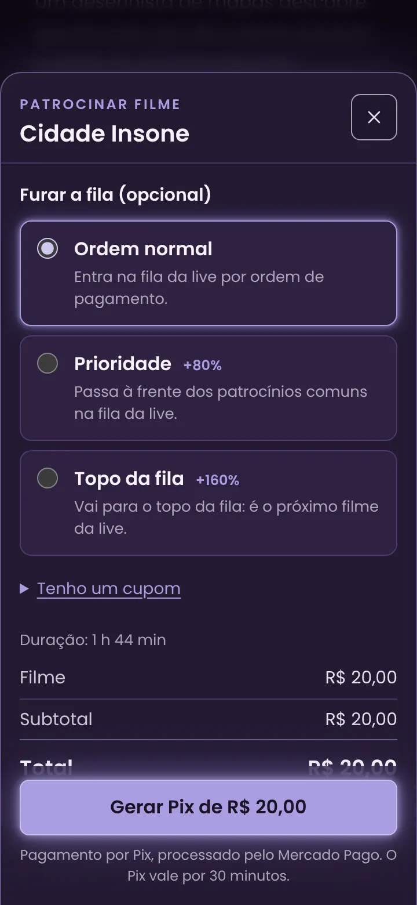
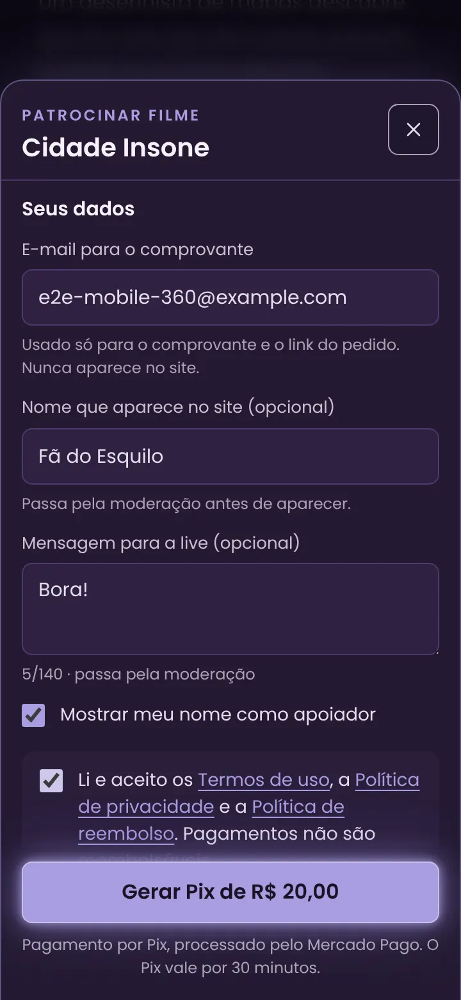
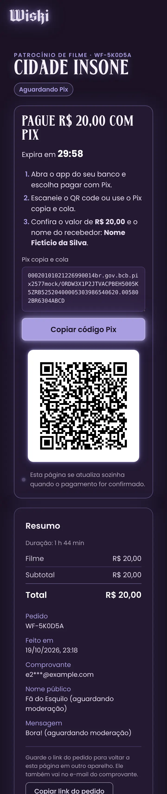
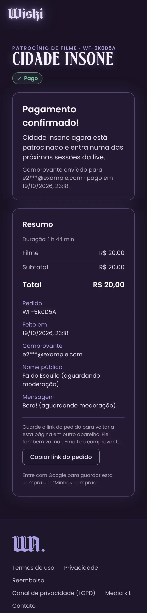
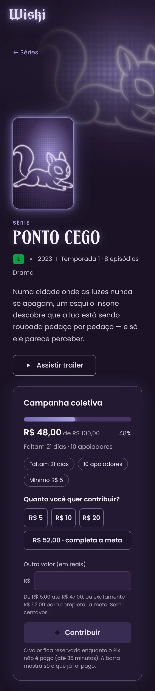
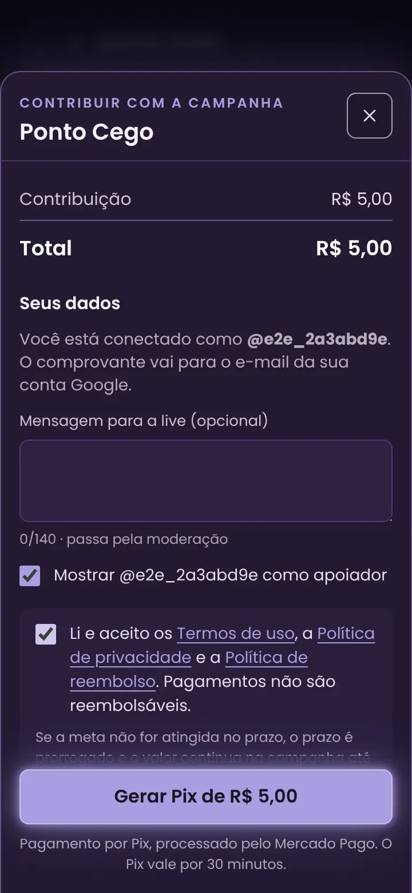
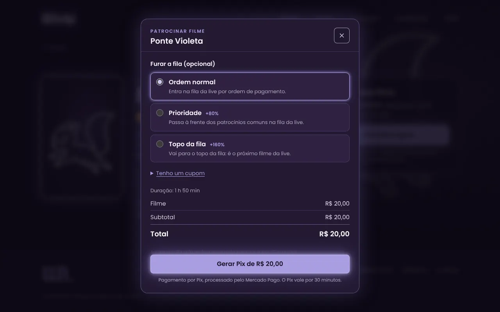
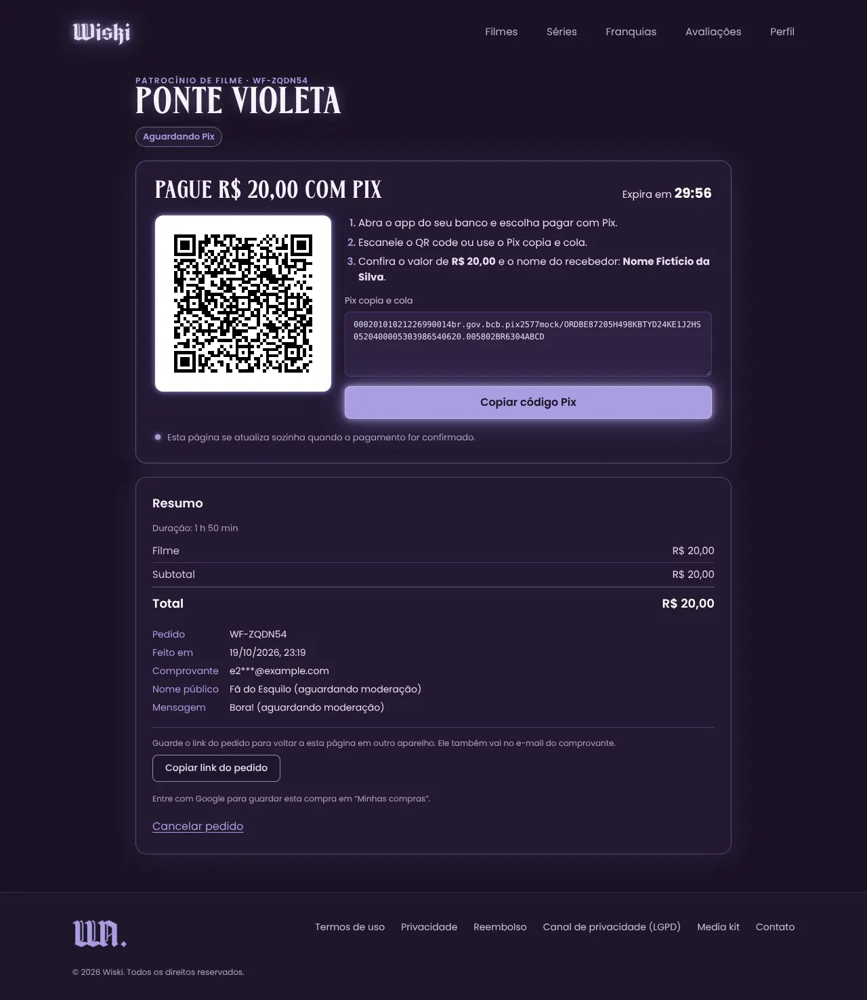
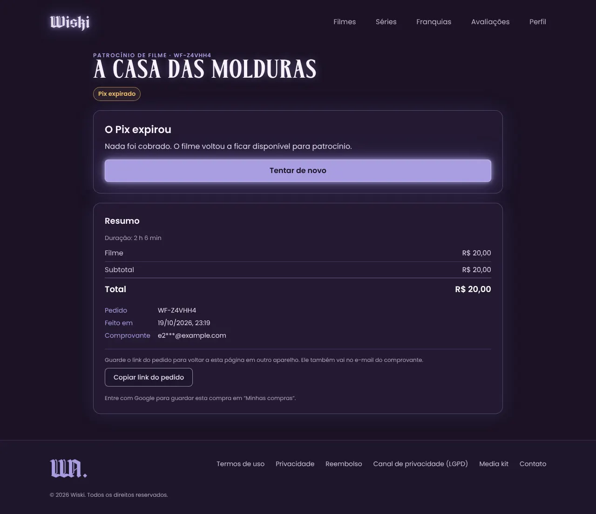
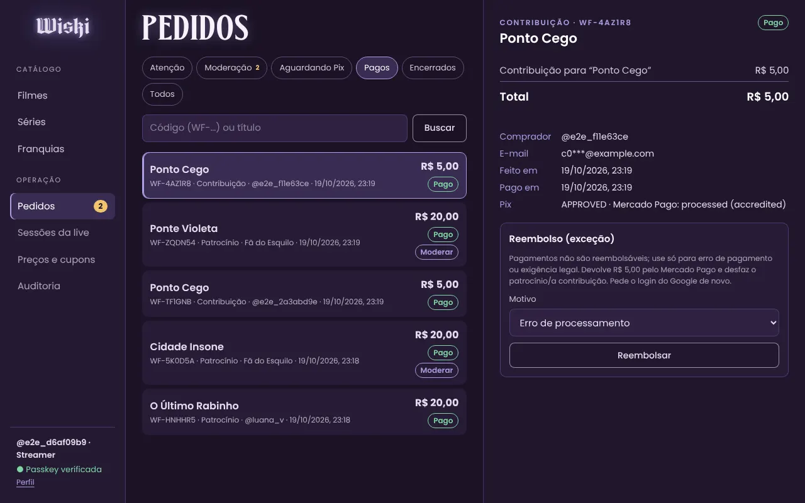

# Wiskiflix — Phase 2 (payments)

> Status: **built and tested** · 2026-10-19 · plan: [`../phase-0/13-phase-2-plan.md`](../phase-0/13-phase-2-plan.md) (decisions D1–D6 as proposed) · Mercado Pago: [`../phase-0/09-mercadopago-setup.md`](../phase-0/09-mercadopago-setup.md) rev 6 · results: [`test-report.md`](./test-report.md)

Phase 2 makes the site take money: a movie is sponsored by one person with a Pix, a series or franchise collects contributions until its goal, and both work for guests or signed-in users. Mercado Pago's **Orders API** creates the Pix; a signed notification (or the 2-minute reconciliation) tells the worker to read the order back from Mercado Pago, check that it is ours and for the right amount, and only then mark it paid — the movie becomes **Patrocinado**, the campaign bar moves, the receipt goes out. Unpaid Pix expire after 30 minutes (+5 grace) and release everything they held. The streamer has `/admin/pedidos` for the exceptions.

Scheduling, sessions, the public queue and the price/voucher screens are Phase 4 (D2/D3); real keys, the Resend domain and the deploy are Phase 5.

## 1. What's in the box

| Area | Where | Notes |
|---|---|---|
| Data model | migrations `20261019180000_p2_payments` (generated) + `20261019180100_p2_constraints` (reviewed SQL) | `Order.buyerKey` (`u:<user>` or `e:<sha256 of the e-mail>`) with a partial unique index = one unpaid order per buyer; `Payment.providerOrderId` + raw provider status; `EmailOutbox`; `QueueJumpSlot.tierIndex` (per-tier daily cap); `AttentionReason` incl. `REFUNDED_OUTSIDE` |
| Pricing | `src/lib/pricing/{config,engine}.ts`, `src/server/pricing/*` | pure engine (integer cents, half-up basis points, BEST_SINGLE discount, queue jump on the pre-discount subtotal, R$ 5–2.000); active rule set v1 seeded; vouchers (race-free, cool-down on wrong codes); queue-jump caps 5/day, 20/week, Topo 1/day, 1 per buyer/day |
| Legal | `src/content/legal/documents.ts`, `src/server/legal/legal.ts`, `/termos` `/privacidade` `/reembolso` | versioned texts, SHA-256 per version pinned by a test; one `LegalAcceptance` per document per order; **marked provisório — production refuses to start with them** |
| Mercado Pago | `src/server/payments/{mercadopago,sync,webhook}.ts` | create / get / cancel / refund with `X-Idempotency-Key`, strict Zod on every response, timeouts + bounded retries, amounts as exact decimal strings; forward-only state machine |
| Checkout | `src/server/orders/{checkout,lifecycle,read,cookie,identity,input,problems}.ts` | Turnstile, Idempotency-Key with sealed replay (24 h), 1 unpaid order per buyer, 2 per IP, movie reserved for 35 min, campaign amount reserved; order link token + `__Host-wf_order` cookie |
| Worker | `src/worker/{main,processors}.ts`, `src/server/jobs/queues.ts`, `npm run worker` | BullMQ on the same Redis: `payment.sync`, `payment.recover`, `payment.cancel`, reconcile every 2 min + nightly 48 h, expiry every minute, e-mail + sweep; graceful stop |
| E-mail | `src/server/email/{templates,transport,outbox}.ts` | outbox written in the same transaction as the event; receipt only after approval, with the order link; campaign extended / funded notices; Resend in production, log + `.tmp/emails` in development |
| Realtime | `src/server/realtime/{publish,sse}.ts` | Redis pub/sub → SSE (heartbeat 20 s, 15 min streams, 6 per IP), schema-checked payloads, no personal data; pages poll every 4 s when SSE is down |
| UI | `src/components/checkout/*`, `src/components/orders/*`, `/pedido/[code]`, Perfil › Minhas compras | movie checkout sheet, contribution box with the live bar, order page (QR + copia e cola, countdown, live status, cancel, "Vincular à minha conta") — [screens](#7-screens) |
| Admin | `/admin/pedidos`, `src/server/orders/admin.ts`, `src/components/admin/{OrdersAdmin,AdminSidebar,AdminGate}.tsx` | list/filters/search, detail, moderation of public names and messages, accept a late Pix (D4), exception refund |
| Operator | `npm run voucher:create` (`scripts/voucher-create.ts`) | creates a voucher (audited without its code) until the Phase 4 screens |
| nginx | `docker/nginx/snippets/{sse,mercadopago-webhook}.conf` | streaming for SSE; the webhook location **passes Mercado Pago's `x-request-id` through** (it is signed) |

### API endpoints added in Phase 2

| Method · path | Access | Purpose |
|---|---|---|
| `POST /api/v1/orders/quote` | public | live price breakdown for a movie (perks only when signed in, read from the DB) |
| `POST /api/v1/orders` | public + Turnstile + `Idempotency-Key` | sponsor a movie: reserves it, creates the Pix (201 + order cookie) |
| `POST /api/v1/campaigns/[id]/contributions` | public + Turnstile + `Idempotency-Key` | contribute to a campaign (whole reais ≥ R$ 5, never leaving less than R$ 5 to go) |
| `GET /api/v1/orders/[code]` · `GET …/events` (SSE) | owner, order cookie or staff (others 404) | status, breakdown and — while payable — the Pix |
| `POST /api/v1/orders/[code]/access` · `…/cancel` · `…/claim` | public · buyer · user | link token → cookie · cancel an unpaid order (cancels the Pix first) · attach a guest order to the account |
| `GET /api/v1/me/orders` | user | Minhas compras |
| `GET /api/v1/campaigns/[id]/events` (SSE) | public | campaign progress (no names, no e-mails) |
| `GET /api/v1/legal/current` | public | current versions + hashes |
| `POST /api/webhooks/mercadopago` | HMAC (`x-signature`), no session, no CSRF | signature + freshness + replay guard → `WebhookEvent` → `payment.sync` → 200 |
| `GET /api/v1/admin/orders` · `GET …/[code]` · `POST …/[code]/moderate` | moderator + passkey | list · detail · approve/reject the public name or message |
| `POST /api/v1/admin/orders/[code]/resolve` · `…/refund` | streamer + passkey + Google step-up (refund also `Idempotency-Key`) | accept a late Pix · exception refund |

All 17 are wrapped in `route()` and in the authz matrix (now 56 handlers × 4 roles).

## 2. Running it on your computer

Everything from R1 still applies ([`../r1/README.md`](../r1/README.md) §2). New:

```bash
npm ci                                            # new packages: bullmq, uqr (QR drawing), fast-check (tests)
npm run db:migrate                                # adds the two Phase 2 migrations
npm run db:seed -- --reset                        # optional: demo catalogue + the price rule set
npm run dev                                       # terminal 1: the site
npm run worker                                    # terminal 2: payments, expiry, e-mail (same .env.local)
```

To try a real **sandbox** Pix, put your **test** credentials into `.env.local` yourself (never in the chat): `MP_ACCESS_TOKEN` (Testes › Credenciais de teste, `APP_USR-…`), `MP_COLLECTOR_ID=3733347216`, `MP_APPLICATION_ID=5754049850745190`, and optionally `PIX_RECIPIENT_NAME`. Without them the checkout says "Pagamentos indisponíveis neste ambiente". Notes:

- Mercado Pago can't send notifications to `localhost`; the worker's 2-minute reconciliation picks up state changes instead.
- A sandbox Pix can't be paid from a bank app; leave one open for 35 minutes to watch it expire and release the movie.
- Without `RESEND_API_KEY`, e-mails are written to the log and to `.tmp/emails/` (open the receipt's order link from there).
- Turnstile uses Cloudflare's public test keys in development (always passes).
- Vouchers: `npm run voucher:create -- --fixed 1500 --max 1` prints a one-use R$ 15,00 voucher (a R$ 20 movie for R$ 5,00).

## 3. How a payment moves

1. **Checkout** — one transaction: movie reserved (or campaign amount moved from *remaining* to *reserved*), voucher use and queue-jump slot held, order + payment + legal acceptances + a **held** receipt written, audit. Then Mercado Pago creates the Pix (`external_reference` = our order id, `PT30M`, same idempotency key on retries). If Mercado Pago fails, the order is cancelled and everything released at once; a create that may still have happened is cancelled later by `payment.recover`.
2. **Notification** — signature (lower-cased id manifest, dual secret), `ts` within ±10 min, `SET NX` on `x-request-id`, `WebhookEvent` row, `payment.sync` queued, 200 in milliseconds. The body is never used for anything else.
3. **Sync** — `GET /v1/orders/{id}`; checks reference, stored ids, amount, BRL, Pix, collector and application. Approved + pending → **PAID** in one transaction (movie SPONSORED / campaign raised, FUNDED at the goal, voucher and slot consumed, receipt released, audit). Any doubt → **NEEDS_ATTENTION**, never PAID. Statuses only move forward.
4. **Expiry** — after 35 min unpaid orders are cancelled at Mercado Pago and **EXPIRED**; holds released. A Pix paid after that → NEEDS_ATTENTION (LATE_APPROVAL) for the streamer (D4).
5. **Exception refund** — STREAMER only, total, through Mercado Pago with the Refund row's own key; applied when the verified order shows `refunded` (movie available again, contribution leaves the campaign).

## 4. Security decisions made while building (all covered by tests)

1. **The webhook body is never trusted.** Only a verified `GET` from Mercado Pago can move money state; foreign collector/application, wrong amount, currency or method → NEEDS_ATTENTION.
2. **nginx keeps Mercado Pago's `x-request-id`.** The server-level `proxy_set_header X-Request-Id $request_id` silently replaced it and every real notification failed the signature — found by the e2e run, fixed in `mercadopago-webhook.conf` (Phase 5 must use it).
3. **QR drawn from the copia-e-cola text** (`src/lib/qr.ts`, one SVG path): no provider image, no `data:` URL, and the QR always matches the text the buyer can copy.
4. **Turnstile through a Trusted Types policy** that accepts exactly one script URL; tokens are single-use, the widget resets after every attempt, the server checks hostname and action.
5. **Idempotency** on every money-moving POST (checkout, contribution, refund): same key + same body replays the first answer; same key + another body → 409.
6. **Buyer key is a hash.** One unpaid order per buyer is a partial unique index on `buyerKey` (`e:` + SHA-256 of the normalised e-mail) — the e-mail is never part of a key or an index.
7. **2 unpaid orders per IP**, counting only orders that are still unpaid (people behind one carrier NAT can buy one after the other).
8. **Order link token** only in the URL fragment (never sent to the server on navigation), exchanged once for a sealed `__Host-` cookie, removed from the address bar; "no access" and "no such order" are the same page and the same 404.
9. **Staff see masked e-mails** (`fa***@example.com`) and never the Pix payload; audit metadata stays allow-listed (no e-mails, amounts only where needed).
10. **Refund**: STREAMER + passkey + fresh Google login; a lease (`REQUESTED → IN_PROCESS`) lets exactly one request call Mercado Pago, a retry after a failure re-sends with the **same** key, a double-click refunds once.
11. **Money is integer cents** to the boundary; Mercado Pago gets exact decimal strings; no floats anywhere (property tests).
12. **Production refuses to start** with provisional legal texts, a test/mismatched Mercado Pago token, missing webhook secret, Resend key or recipient name, or endpoint overrides on a non-localhost origin.
13. **E-mail**: templates escape every value, no remote images, subjects can't carry header breaks; the sealed order-link token in the outbox is erased once the receipt is sent.

## 5. Deviations from the plan, and why

| Plan | What was built | Why |
|---|---|---|
| step 1: `media.process` moves to the worker | image processing stays in the upload request | admin-only uploads, a few seconds at most; moving it adds a queue and a "processing…" state with no benefit at this size. Revisit if uploads get slow. |
| step 9: `campaigns.deadline` job | no job: a passed deadline is **derived** at read time and checked inside the contribution transaction (`deadlineAt > now`) | nothing can lag behind the clock; "Prazo encerrado" shows the second the deadline passes |
| D4: accept a late Pix | accepted orders keep their price; the voucher use and queue-jump slot released at expiry are **not** taken again | re-taking them could fail or overrun a cap after the fact; the admin screen says so before accepting |
| 11 §2.2 "last contribution capped at what's left" | a contribution must close the goal exactly or leave ≥ R$ 5; goal changes follow the same rule | a remainder of R$ 1–4 could never be paid (minimum R$ 5) — the campaign would stall |
| "2 pending per IP" | counts unpaid orders only | the first version counted every checkout in 35 minutes |
| Refund side effects | an approved refund of a **paid** order releases the movie / takes the contribution out (re-opening a funded, not-yet-scheduled campaign) | otherwise a refunded sponsor would still hold the movie |

## 6. Open items / needed from you

| # | When | What |
|---|---|---|
| S2 | before go-live | Production User ID and Application ID — the ids sent on 2026-10-19 are the test ones (09, Received). |
| Q13 | before go-live | The lawyer's terms, privacy and refund texts (incl. the crowdfunding wording). Publishing them = new `version` + `provisional: false` in `src/content/legal/documents.ts`. |
| P2-a / P2-b | Phase 5 | Resend + `mail.wiski.fun` DNS; Mercado Pago webhook (events **Order (Mercado Pago)** + chargebacks) and its secret; real Turnstile keys. |
| — | when the LGPD export lands | include the buyer's orders (there is no data export yet). |

## 7. Screens

Production build behind nginx, mocked Mercado Pago, from the e2e run (`tests/e2e/payments.spec.ts`).

| Phone (360 px) | | |
|---|---|---|
|  |  |  |
|  |  |  |

| Desktop (1280 px) | |
|---|---|
|  |  |
|  |  |
